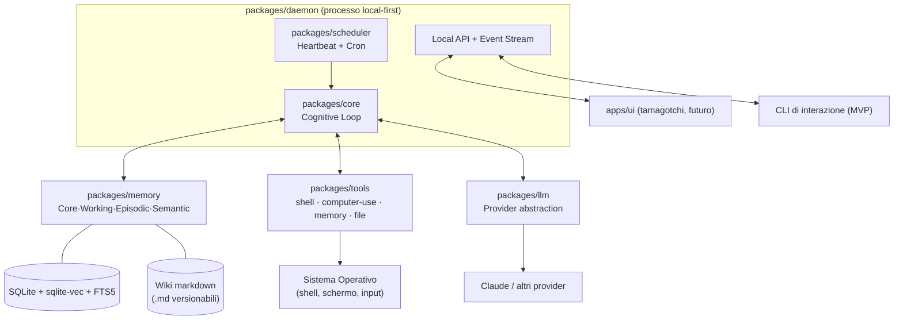

# 01 — Panoramica Architetturale

## Scopo

Fornire la mappa d'insieme: i componenti principali, come dialogano, e il flusso dei dati attraverso il ciclo cognitivo. I dettagli dei singoli sottosistemi sono nei documenti dedicati.

## Vista d'insieme

OpenMate è un **monorepo TypeScript/Node** ([ADR-0001](adr/0001-runtime-ts-node-monorepo.md)) organizzato in package. Al centro c'è un **daemon** che ospita il **cognitive loop**; attorno gravitano memoria, tool, provider LLM, scheduler e (in futuro) la UI.

## Componenti principali

| Package | Responsabilità |
|---|---|
| **`packages/daemon`** | Processo che tiene vivo l'agente; espone una **API locale + event stream** a cui CLI/UI si sottoscrivono; ospita loop e scheduler. |
| **`packages/core`** | Il **cognitive loop** (percepire → recuperare → pianificare → agire → riflettere → consolidare) e la macchina a stati dell'agente. Vedi [02](02-agent-loop-and-autonomy.md). |
| **`packages/scheduler`** | **Heartbeat** (tick idle configurabile) e trigger *cron*/event-driven che risvegliano il loop. |
| **`packages/memory`** | Il sistema di memoria a livelli e i tool di recall agentico. Vedi [03](03-memory-architecture.md). |
| **`packages/tools`** | Registry dei tool e implementazioni: shell, computer-use, memoria, file. Vedi [04](04-tools-and-capabilities.md). |
| **`packages/llm`** | Il **`ReasoningBackend`** (OpenMate possiede il loop, B-first) e l'astrazione provider (chat, tool-use, vision, streaming). Vedi [07](07-llm-provider-abstraction.md), [ADR-0009](adr/0009-reasoning-backend-own-loop.md). |
| **`packages/config`** | Configurazione, gestione segreti/chiavi, profili. |
| **`apps/ui`** | Esperienza tamagotchi (fase successiva). Vedi [08](08-ui-tamagotchi.md). |

> I nomi dei package sono normativi e devono restare coerenti con [09](09-tech-stack-and-repo-layout.md).

## Data-flow di un ciclo

1. **Trigger** — lo `scheduler` emette un heartbeat, oppure arriva un evento (messaggio utente, cron, webhook).
2. **Perceive** — il `core` raccoglie il contesto: input dell'evento + **core memory** (sempre iniettata) + stato corrente.
3. **Retrieve** — se serve, il `core` invoca i **tool di memoria** (`packages/memory`) per cercare episodic/semantic rilevanti.
4. **Plan/Act** — il `core` interpella `packages/llm`; il modello decide ed eventualmente chiama **tool** (`packages/tools`) → shell, computer-use, scrittura memoria.
5. **Reflect** — il `core` valuta l'esito e aggiorna goal/task.
6. **Consolidate** — periodicamente (tipicamente su heartbeat idle), gli episodic recenti vengono riassunti in aggiornamenti alla **wiki semantica** e ripuliti.
7. **Emit** — eventi di stato (mood/azioni) vengono pubblicati sull'event stream per CLI/UI.

## Confini e contratti

- **Il daemon è l'unico processo con stato.** CLI e UI sono client "sottili" che parlano con la sua API locale — questo permette di sviluppare la UI tamagotchi in modo indipendente ([08](08-ui-tamagotchi.md)).
- **I tool sono l'unico modo in cui l'agente tocca il mondo** (shell, device, memoria). Nessuna capacità "nascosta" nel core: tutto passa dal registry con permessi dichiarati ([04](04-tools-and-capabilities.md), [06](06-security-and-permissions.md)).
- **La memoria è l'unico stato persistente di lungo periodo** ed è ispezionabile dall'utente ([03](03-memory-architecture.md)).

## Rischi e questioni aperte

- Confine esatto tra `core` e `scheduler` quando arrivano eventi durante un ciclo in corso (coda vs interruzione) — vedi [02](02-agent-loop-and-autonomy.md).
