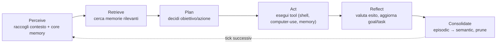
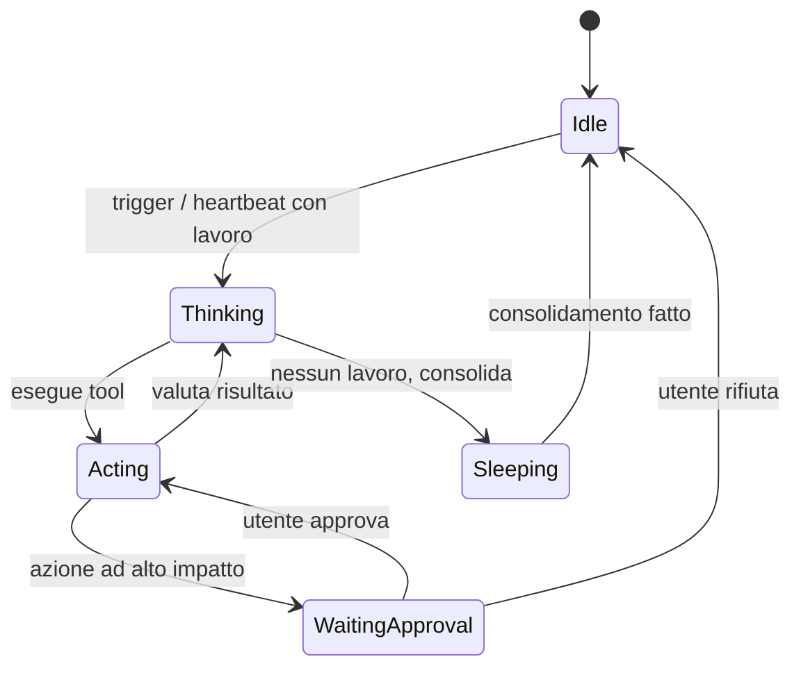

# 02 — Loop dell'Agente e Autonomia

## Scopo

Definire come OpenMate è **autonomo**: il ciclo cognitivo che esegue, come l'heartbeat lo risveglia, come gestisce eventi e obiettivi, e la macchina a stati che rende l'agente "vivo".

## Decisione

Adottiamo un **cognitive cycle guidato da heartbeat** ([ADR-0002](adr/0002-autonomy-cognitive-cycle-heartbeat.md)): l'agente ha un ciclo mentale ricorrente che si attiva sia su **tick periodici** (quando idle) sia su **eventi** (input utente, cron, webhook). Ogni ciclo può sia *agire* sul mondo sia *consolidare* la memoria — il tick idle è anche il momento in cui l'agente "dorme e sogna".

## Il ciclo cognitivo



| Fase | Cosa fa | Dipende da |
|---|---|---|
| **Perceive** | Costruisce il contesto: trigger + core memory sempre iniettata + stato agente. | [03](03-memory-architecture.md) |
| **Retrieve** | *Se serve*, l'agente invoca i tool di memoria per recuperare episodic/semantic. Non è RAG automatico: è recall agentico ([ADR-0005](adr/0005-memory-agentic-recall.md)). | [03](03-memory-architecture.md) |
| **Plan** | Il modello LLM decide il prossimo passo verso i goal correnti. | [07](07-llm-provider-abstraction.md) |
| **Act** | Esegue tool con permessi (shell, computer-use, memory, file). | [04](04-tools-and-capabilities.md), [06](06-security-and-permissions.md) |
| **Reflect** | Valuta l'esito, aggiorna lo stato di goal e task, registra un evento episodic. | [03](03-memory-architecture.md) |
| **Consolidate** | Riassume gli episodic recenti in aggiornamenti alla wiki semantica; applica strategie di oblio/prune. Tipicamente su tick idle. | [03](03-memory-architecture.md) |

## Heartbeat e trigger

Lo `scheduler` risveglia il loop in tre modi:

- **Heartbeat (tick idle)** — intervallo configurabile (es. ogni N minuti). Se non c'è nulla di urgente, l'agente può decidere di "non fare nulla" (economia) oppure fare *manutenzione*: avanzare goal a lungo termine, consolidare memoria, controlli proattivi.
- **Cron** — job pianificati con orario esplicito ("ogni mattina alle 8").
- **Eventi** — input dell'utente (via CLI/UI), webhook, notifiche di sistema.

> **Economia degli heartbeat:** un tick non deve sempre chiamare l'LLM. Un *pre-check* leggero (deterministe: ci sono task scaduti? eventi in coda? soglia di consolidamento raggiunta?) decide se avviare un ciclo cognitivo completo. Questo tiene sotto controllo costi e rumore.

> **Proattività di default: moderata** ([ADR-0012](adr/0012-default-proactivity-moderate.md)). Sugli heartbeat l'agente avanza i goal e consolida in silenzio; interviene/notifica l'utente **solo quando ha qualcosa di utile** e non ripetitivo-urgente. Il livello è configurabile ([09](09-tech-stack-and-repo-layout.md)).

## Modello di goal e task

L'autonomia richiede obiettivi persistenti tra un tick e l'altro:

- **Goal** — intenti a lungo termine ("tieni aggiornato il riepilogo del progetto X"). Persistiti in memoria.
- **Task** — unità di lavoro concrete derivate dai goal o dagli eventi; hanno stato (`pending`/`in_progress`/`blocked`/`done`) e possibile scadenza.
- Nel ciclo, **Plan** seleziona il prossimo task; **Reflect** ne aggiorna lo stato.

Questo dà proattività senza adottare un planner pesante separato: la pianificazione emerge dal ciclo + dallo stato dei goal/task in memoria.

## Macchina a stati dell'agente

Gli stati sono anche il vocabolario "emotivo" per la UI tamagotchi ([08](08-ui-tamagotchi.md)):



Ogni transizione emette un evento sull'event stream del daemon.

## Concorrenza: eventi durante un ciclo (deciso)

Se arriva un evento mentre un ciclo è in corso: lo **step atomico** in corso completa, poi il loop drena una **coda con priorità**; il **messaggio utente preempta** gli altri item. L'interruzione hard (kill-switch) è trattata in [06](06-security-and-permissions.md).

## Limiti operativi (deciso)

Per prevenire loop-runaway e costi incontrollati, ogni ciclo ha un **budget** applicato dal `core`:
- **max step** per ciclo, **max token** e **wall-clock** per ciclo;
- **rate-limit per tool** e **circuit breaker** su errori ripetuti;
- superato il budget → il ciclo si chiude e (se serve) chiede all'utente.

## Interfacce (bozza, non normativa)

```ts
interface CognitiveCycleInput {
  trigger: { kind: "heartbeat" | "cron" | "event"; payload?: unknown };
  timestamp: string;
}

interface AgentState {
  status: "idle" | "thinking" | "acting" | "sleeping" | "waiting_approval";
  activeGoalId?: string;
  activeTaskId?: string;
}
```

## Rischi e questioni aperte

- **Frequenza heartbeat vs costo:** specialmente col computer-use vision ([05](05-device-interaction.md)).
- **Priorità e fairness** tra goal a lungo termine e reattività agli eventi utente.
- Confine preciso `core`/`scheduler` per la gestione della coda eventi (vedi [01](01-architecture-overview.md)).
