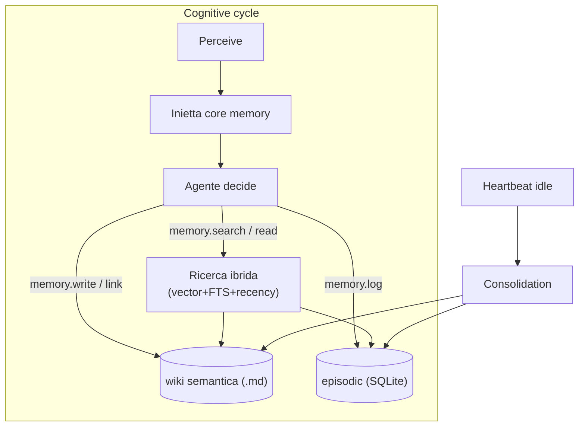

# 03 — Architettura della Memoria

> **Documento cardine.** La memoria è il cuore di OpenMate: ciò che lo distingue da un chatbot è la capacità di ricordare, consolidare e curare la conoscenza nel tempo.

## Scopo

Definire come OpenMate immagazzina, recupera e fa evolvere la conoscenza. Traduce le tre intuizioni iniziali — *LLM Wiki*, *FileSystem Long Term*, *Short Term* — in un'architettura cognitiva coerente, e fissa le decisioni su substrato, recall ed embeddings.

## Principio guida

Le tre idee non sono alternative in competizione: sono **livelli complementari** di un'unica architettura, ispirata alle scienze cognitive (memoria episodica vs semantica) e agli agenti moderni (MemGPT/Letta, Mem0, *Generative Agents* di Stanford).

| Livello | Cos'è | Corrisponde a |
|---|---|---|
| **Core memory** | Blocchi sempre in-context: persona del tamagotchi + profilo utente. Auto-editati. | (parte di) *Short Term* |
| **Working memory** | Finestra attiva + buffer recente, con compattazione/summarization. | *Short Term* |
| **Episodic** | Log append-only di eventi/azioni: "cosa è successo e quando". | — |
| **Semantic** | Conoscenza durevole come **wiki markdown** editabile e linkabile. | *LLM Wiki* + *FileSystem Long Term* |
| **Retrieval** | Indice di ricerca ibrida sopra episodic + semantic. | — |
| **Consolidation** | Processo (sull'heartbeat) che trasforma episodic in semantic e fa oblio. | — |

## Decisioni chiave

1. **Substrato: ibrido markdown + SQLite** ([ADR-0004](adr/0004-memory-hybrid-markdown-sqlite.md)) — la wiki semantica è markdown leggibile e versionabile; episodic e indici stanno in SQLite (`sqlite-vec` + FTS5).
2. **Recall: agentico + core iniettata** ([ADR-0005](adr/0005-memory-agentic-recall.md)) — la core memory è sempre in contesto; per il resto l'agente usa *tool* e decide quando cercare/leggere/scrivere. Niente RAG automatico.
3. **Embeddings: locali + fallback API** ([ADR-0006](adr/0006-embeddings-local-with-api-fallback.md)) — default locale (Ollama `nomic-embed-text` / `transformers.js`), fallback su API se indisponibile.

## I livelli in dettaglio

### Core memory
Blocchi compatti **sempre presenti nel prompt**, che l'agente può riscrivere:
- **`persona`** — chi è il tamagotchi: carattere, tono, valori. Dà continuità di identità.
- **`user`** — profilo dell'utente: chi è, preferenze durevoli, fatti stabili.

Sono limitati in dimensione (budget di token fisso); quando si saturano, l'agente promuove il contenuto in eccesso verso la memoria semantica. È il meccanismo *self-editing memory* di MemGPT.

### Working memory
Il contesto di lavoro del ciclo corrente: messaggi recenti, risultati di tool, scratchpad. Quando cresce oltre soglia, viene **compattata** (riassunto ricorsivo) e gli elementi salienti finiscono in episodic. Non è persistente oltre la sessione/attività.

### Episodic memory
Registro **append-only** di ciò che accade: eventi, decisioni, azioni e loro esiti. Vive in SQLite. Ogni record ha timestamp, tipo, attore, contenuto e (opzionale) embedding. Risponde a domande come "cosa ho fatto ieri?" e alimenta la consolidation.

### Semantic memory — la LLM Wiki
Conoscenza durevole e distillata come **file markdown** con:
- **Frontmatter** (`name`, `description`, `type`, metadata) per rilevanza e classificazione.
- **Corpo** in prosa leggibile.
- **Link `[[nome]]`** tra note per costruire un grafo di conoscenza navigabile.

Un file = un concetto/entità/fatto. È **human-readable e Git-versionabile**: l'utente può leggere e correggere il "cervello" dell'agente. Un file indice (es. `WIKI.md`) tiene una riga per nota per orientarsi.

> Questo strato è deliberatamente modellato sul pattern di memoria a file usato da agenti come Claude Code: frontmatter + link + indice.

### Retrieval — ricerca ibrida
Sopra episodic e semantic gira una ricerca che combina tre segnali:
- **Vector** (`sqlite-vec`) — similarità semantica sugli embedding.
- **Keyword** (FTS5) — match lessicale esatto.
- **Recency/importanza** — pesatura temporale e salienza (à la Generative Agents).

Esposta all'agente come tool, non applicata automaticamente.

### Consolidation — "dormire e sognare"
Sull'heartbeat idle ([02](02-agent-loop-and-autonomy.md)), un processo:
1. Legge gli episodic non ancora consolidati.
2. Estrae fatti/insight durevoli e li **scrive/aggiorna nella wiki semantica** (creando link `[[…]]`).
3. Applica **oblio = consolida + archivia, mai delete** ([ADR-0011](adr/0011-memory-forgetting-consolidate-archive.md)): gli episodic consolidati vengono **archiviati in forma compressa** (non cancellati), deduplicati; l'archivio non è iniettato in contesto ma resta recuperabile via retrieval.

È ciò che impedisce la crescita illimitata e trasforma esperienza grezza in conoscenza, **senza perdita irreversibile**.

## Recall agentico: i tool della memoria

L'agente interagisce con la memoria tramite un set di tool ([04](04-tools-and-capabilities.md)):

| Tool | Scopo |
|---|---|
| `memory.search` | Ricerca ibrida su episodic + semantic; ritorna riferimenti + estratti. |
| `memory.read` | Legge il contenuto pieno di una nota semantica o di un record episodic. |
| `memory.write` | Crea/aggiorna una nota semantica (con frontmatter + link). |
| `memory.link` | Collega due note `[[…]]`. |
| `memory.log` | Appende un evento episodic (spesso automatico in *Reflect*). |
| `memory.core.edit` | Modifica un blocco di core memory (`persona`/`user`). |

La **core memory** è iniettata a ogni ciclo; tutto il resto è on-demand, deciso dall'agente.

## Modello dati (bozza)

**Wiki semantica** — file su disco:
```
memory/
  WIKI.md                 # indice: una riga per nota
  persona.md              # core memory (persona)
  user-profile.md         # core memory (user)
  notes/
    progetto-x.md         # nota semantica con frontmatter + [[link]]
    persona-mario-rossi.md
```

```markdown
---
name: progetto-x
description: Stato e contesto del progetto X dell'utente
type: project
---
Il progetto X riguarda ... Collegato a [[persona-mario-rossi]].
```

**SQLite** — episodic + indici:
```sql
CREATE TABLE episodic (
  id        INTEGER PRIMARY KEY,
  ts        TEXT NOT NULL,         -- ISO 8601
  kind      TEXT NOT NULL,         -- event | action | observation | reflection
  actor     TEXT NOT NULL,         -- agent | user | system
  content   TEXT NOT NULL,
  consolidated INTEGER DEFAULT 0
);

-- Indice vettoriale (sqlite-vec) su episodic e chunk della wiki
CREATE VIRTUAL TABLE mem_vec USING vec0(embedding FLOAT[768]);

-- Indice full-text (FTS5) su content
CREATE VIRTUAL TABLE mem_fts USING fts5(content, source_id, source_kind);
```

## Flusso lettura/scrittura



## Interfaccia astratta (bozza, non normativa)

```ts
interface MemorySystem {
  coreBlocks(): Promise<Record<"persona" | "user", string>>;
  editCore(block: "persona" | "user", content: string): Promise<void>;

  search(query: string, opts?: { k?: number; scope?: "episodic" | "semantic" | "all" }): Promise<MemoryHit[]>;
  read(ref: MemoryRef): Promise<string>;
  writeNote(note: SemanticNote): Promise<void>;
  link(from: string, to: string): Promise<void>;
  log(event: EpisodicEvent): Promise<void>;

  consolidate(now: string): Promise<ConsolidationReport>;
}
```

## Decisioni operative (chiuse)

- **Sincronizzazione file ↔ indice.** La wiki markdown è source-of-truth del semantico. `memory.write` aggiorna file **e** indice atomicamente (write-through); un **watcher** + riconciliazione allo startup basata su **content-hash** cattura le modifiche fatte a mano; la reindicizzazione è **idempotente**.
- **Chunking della wiki.** Per **sezione** (heading), con fallback per-nota; ogni chunk conserva il riferimento alla nota sorgente.
- **Oblio.** Consolida + archivia, **mai delete** di default ([ADR-0011](adr/0011-memory-forgetting-consolidate-archive.md)).

## Rischi e questioni aperte

- **Dimensione degli embedding** e scelta del modello locale (influisce sullo schema `vec0`; cambiare modello richiede reindicizzazione).
- **Conflitti di scrittura** se l'utente edita la wiki mentre l'agente consolida (mitigati da write-through + content-hash, ma il caso concorrente va gestito).
- **Formato/tier dell'archivio** e strategia di recupero on-demand dall'archivio compresso.
- **Privacy dei fallback API embeddings:** cosa esce dal dispositivo e con quale consenso ([06](06-security-and-permissions.md)).
