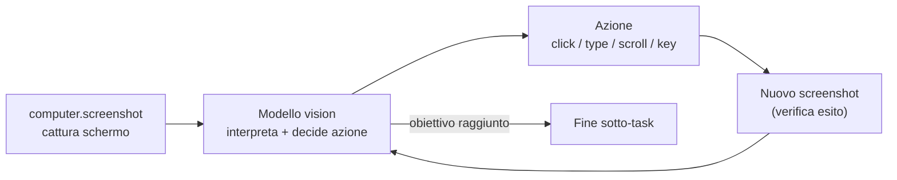

# 05 — Interazione col Dispositivo (Computer-Use Vision)

## Scopo

Definire come OpenMate interagisce con il sistema a livello di GUI: muove mouse e tastiera, legge lo schermo. La scelta è **computer-use basato su vision**, non automazione scriptata.

## Decisione

OpenMate interagisce col dispositivo **esclusivamente tramite computer-use vision** ([ADR-0003](adr/0003-device-interaction-vision-only.md)): cattura screenshot, un **modello vision-capable** interpreta lo schermo e decide le azioni, che vengono eseguite come input mouse/tastiera. Nessun percorso di automazione scriptata OS-specifica (AppleScript/Accessibility) nel core.

**Perché vision-only:** massima generalità (funziona con qualunque app, anche senza API/accessibilità), un solo paradigma da mantenere, e sposa l'idea di un agente general-purpose che "vede" come un utente. Il prezzo — latenza e costo — è accettato e mitigato (vedi sotto).

## Il loop di computer-use

Questo loop è un sotto-processo della fase **Act** del ciclo cognitivo ([02](02-agent-loop-and-autonomy.md)): l'agente entra in modalità computer-use per un task GUI e ne esce col risultato.

## Tool esposti

| Tool | Permesso | Note |
|---|---|---|
| `computer.screenshot` | safe | Cattura (eventualmente ridimensionata) dello schermo/finestra. |
| `computer.click` | dangerous | Click a coordinate (o su elemento individuato dal modello). |
| `computer.type` | dangerous | Digita testo. |
| `computer.scroll` | dangerous | Scroll direzionale. |
| `computer.key` | dangerous | Pressione tasti/scorciatoie. |

Tutte le azioni di input sono `dangerous` ([06](06-security-and-permissions.md)): possono avere effetti irreversibili sulla macchina.

## Requisiti tecnici

- **Modello vision-capable** obbligatorio nel provider LLM ([07](07-llm-provider-abstraction.md)); il default Claude soddisfa il requisito.
- **Permessi macOS**: *Screen Recording* (per gli screenshot) e *Accessibility* (per il controllo di mouse/tastiera). L'app deve guidarne la concessione al primo avvio.
- **Coordinate e scaling**: gestire display Retina/HiDPI, mapping tra pixel logici e fisici, e multi-monitor.

> Piattaforma primaria iniziale: **macOS**. Linux/Windows sono estensioni future (la stessa astrazione vision-based è portabile; cambiano i backend di cattura/input e i permessi).

## Sicurezza e safety

- **Conferma su azioni distruttive**: azioni che il modello ritiene rischiose (invio, eliminazione, pagamenti, comandi di sistema) passano da approval gate ([06](06-security-and-permissions.md)).
- **Kill-switch**: l'utente può interrompere immediatamente un loop di computer-use (`AbortSignal`).
- **Audit visivo**: registrare lo screenshot + azione decisa aiuta il debugging e l'accountability (attenzione alla privacy — vedi sotto).

## Costo e latenza (mitigazioni adottate)

Il vision-only è costoso su cicli frequenti. Mitigazioni di default:
- **Non attivare computer-use su ogni heartbeat**: solo quando un task lo richiede (pre-check deterministico, [02](02-agent-loop-and-autonomy.md)).
- **Ridimensionare/comprimere** gli screenshot prima dell'invio al modello.
- **Limitare gli step** del loop per task (budget di azioni), con fallback a chiedere all'utente.
- **Cache visiva** dello stato quando lo schermo non cambia.

## Rischi e questioni aperte

- **Affidabilità del grounding** (click sulle coordinate giuste) tra risoluzioni/temi diversi.
- **Privacy degli screenshot**: se e quanto conservarli nell'audit; redazione di contenuti sensibili.
- **Latenza percepita** per task interattivi: l'esperienza tamagotchi deve comunicare che l'agente "sta guardando/agendo" ([08](08-ui-tamagotchi.md)).
- **Portabilità** dei backend di cattura/input oltre macOS.
