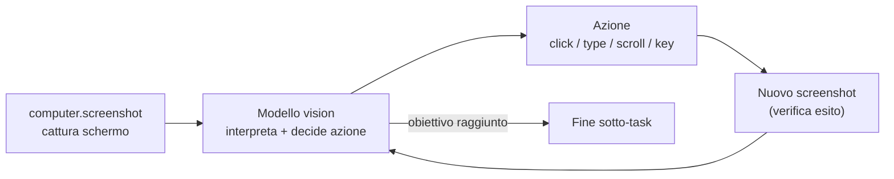

# 05 — Interazione col Dispositivo (Computer-Use Vision)

> **Stato: implementato (Fase 2).** Realizzazione con *vision generica model-agnostic* + **nut.js** (cross-platform). Vedi la sezione "Realizzazione" in fondo.

## Scopo

Definire come OpenMate interagisce con il sistema a livello di GUI: muove mouse e tastiera, legge lo schermo. La scelta è **computer-use basato su vision**, non automazione scriptata.

## Decisione

OpenMate interagisce col dispositivo **esclusivamente tramite computer-use vision** ([ADR-0003](adr/0003-device-interaction-vision-only.md)): cattura screenshot, un **modello vision-capable** interpreta lo schermo e decide le azioni, che vengono eseguite come input mouse/tastiera. Nessun percorso di automazione scriptata OS-specifica (AppleScript/Accessibility) nel core.

**Perché vision-only:** massima generalità (funziona con qualunque app, anche senza API/accessibilità), un solo paradigma da mantenere, e sposa l'idea di un agente general-purpose che "vede" come un utente. Il prezzo — latenza e costo — è accettato e mitigato (vedi sotto).

## Il loop di computer-use

Questo loop è un sotto-processo della fase **Act** del ciclo cognitivo ([02](02-agent-loop-and-autonomy.md)): l'agente entra in modalità computer-use per un task GUI e ne esce col risultato.

### Verifica via screenshot (screenshot-verify)

Ogni azione è seguita da una **verifica esplicita**: si cattura un nuovo screenshot e si controlla che lo **stato atteso** si sia realizzato *prima* di procedere. Non si assume mai che un click abbia avuto effetto. Su **mismatch** (lo schermo non è cambiato come previsto) l'agente riprova o ri-pianifica, entro il budget di step ([02](02-agent-loop-and-autonomy.md)).

- Ogni step porta con sé un'**aspettativa verificabile** ("dopo il click dovrebbe comparire X"), controllata dal modello vision sullo screenshot successivo.
- Riduce gli errori di *grounding* (coordinate sbagliate) e rende il loop robusto ad app lente o layout inattesi.
- Lo screenshot pre/post azione alimenta anche l'**audit visivo** (sotto).

> Pattern ispirato alle skill `capture-verify`/`screenshot-verify` di [OpenWork](https://github.com/different-ai/openwork); è indipendente dal modello e dal reasoning backend.

## Tool esposti

| Tool | Permesso | Note |
|---|---|---|
| `computer.screenshot` | safe | Cattura (eventualmente ridimensionata) dello schermo/finestra. |
| `computer.click` | dangerous | Click a coordinate (o su elemento individuato dal modello). |
| `computer.type` | dangerous | Digita testo. |
| `computer.scroll` | dangerous | Scroll direzionale. |
| `computer.key` | dangerous | Pressione tasti/scorciatoie. |

Tutte le azioni di input sono `dangerous` ([06](06-security-and-permissions.md)): possono avere effetti irreversibili sulla macchina.

## Requisiti tecnici

- **Modello vision-capable** obbligatorio nel provider LLM ([07](07-llm-provider-abstraction.md)); il default Claude soddisfa il requisito.
- **Permessi macOS**: *Screen Recording* (per gli screenshot) e *Accessibility* (per il controllo di mouse/tastiera). L'app deve guidarne la concessione al primo avvio.
- **Coordinate e scaling**: gestire display Retina/HiDPI, mapping tra pixel logici e fisici, e multi-monitor.

> Piattaforma primaria iniziale: **macOS**. Linux/Windows sono estensioni future (la stessa astrazione vision-based è portabile; cambiano i backend di cattura/input e i permessi).

## Sicurezza e safety

- **Conferma su azioni distruttive**: azioni che il modello ritiene rischiose (invio, eliminazione, pagamenti, comandi di sistema) passano da approval gate ([06](06-security-and-permissions.md)).
- **Kill-switch**: l'utente può interrompere immediatamente un loop di computer-use (`AbortSignal`).
- **Audit visivo**: registrare lo screenshot + azione decisa aiuta il debugging e l'accountability (attenzione alla privacy — vedi sotto).

## Costo e latenza (mitigazioni adottate)

Il vision-only è costoso su cicli frequenti. Mitigazioni di default:
- **Non attivare computer-use su ogni heartbeat**: solo quando un task lo richiede (pre-check deterministico, [02](02-agent-loop-and-autonomy.md)).
- **Ridimensionare/comprimere** gli screenshot prima dell'invio al modello.
- **Limitare gli step** del loop per task (budget di azioni), con fallback a chiedere all'utente.
- **Cache visiva** dello stato quando lo schermo non cambia.

## Rischi e questioni aperte

- **Affidabilità del grounding** (click sulle coordinate giuste) tra risoluzioni/temi diversi — mitigata ma non risolta da screenshot-verify.
- **Privacy degli screenshot**: se e quanto conservarli nell'audit; redazione di contenuti sensibili.
- **Latenza percepita** per task interattivi: l'esperienza tamagotchi deve comunicare che l'agente "sta guardando/agendo" ([08](08-ui-tamagotchi.md)).
- **Portabilità** dei backend di cattura/input oltre macOS.

---

## Realizzazione (Fase 2)

**Approccio: vision generica model-agnostic + nut.js.** Scartata la via del tool "computer" nativo di Anthropic per non legarsi a un singolo provider (avrebbe richiesto provider Anthropic + modello Claude). I tool `computer.*` restituiscono lo **screenshot come immagine** (content-part via AI SDK `toModelOutput`) → qualsiasi modello vision "vede"; risponde con coordinate; l'executor esegue e rimanda un nuovo screenshot.

### Componenti
- **`packages/computer`** — executor cross-platform su **nut.js** (fork MIT `@nut-tree-fork/nut-js`): `screenshot()` (cattura + downscale a ~1366px via `jimp`), `move/click/doubleClick/type/key/scroll`, `toLogical()` (mappa pixel-immagine → coordinate di puntamento, gestisce retina/HiDPI e downscale), `detectCapabilities()` (rileva Wayland).
- **`packages/tools`** — `createComputerTools(executor)`: `computer.screenshot/click/type/key/scroll/move/double_click`; `Tool.toModelOutput` per i risultati-immagine; **gate di sessione** in `executeGated` (i `computer.*` chiedono l'approvazione **una volta per ciclo**, poi le successive dello stesso ciclo partono da sole, tutte auditate).
- **`packages/config`** — `computerUse.enabled` (default **off**).
- **`packages/daemon`** — monta i tool solo se `enabled` **e** `capabilities().supported`; espone lo stato su `GET /status`.
- **`apps/ui`** — toggle in Impostazioni + sezione permessi per-OS (macOS apre i pannelli Privacy) + indicatore "🖥️ controllo schermo attivo" nell'overlay; il kill-switch **Interrompi** ferma tra un'azione e l'altra.

### Matrice di supporto
| OS | Screenshot | Input | Setup |
|---|---|---|---|
| macOS | ✅ | ✅ | Permessi: Registrazione schermo + Accessibilità (guida in Impostazioni) |
| Windows | ✅ | ✅ | Nessuno (nota: alcuni antivirus segnalano l'input sintetico) |
| Linux / X11 | ✅ | ✅ | Sessione X11 |
| Linux / Wayland | ⚠️ | ❌ | Iniezione input non supportata → rilevato e disabilitato con messaggio |

### Vincoli
- Serve un **modello con vision** (es. `gpt-4o`); i modelli senza vision non possono usare il computer-use (l'agente lo segnala invece di bloccarsi).
- **Grounding** meno preciso rispetto al tool Claude nativo → mitigato con downscale + screenshot di verifica.
- **Privacy**: gli screenshot vengono inviati al modello (cloud) → opt-in, default off, approvazione di sessione.
