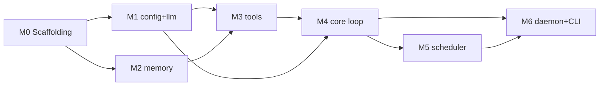

# 11 — Piano di Implementazione MVP (Fase 1)

## Scopo

Piano **eseguibile task-by-task** per l'MVP ([10](10-roadmap.md) Fase 1): task ordinati con dipendenze, contratti finalizzati, schemi dati finali, milestone con test di accettazione, e librerie pinnate. Le fasi 2-5 restano roadmap.

## Confini dell'MVP

**Dentro:** daemon + cognitive loop base + heartbeat/cron + `DirectProviderBackend` (Claude) + tool (`shell.run`, `file.*`, `memory.*`) + memoria base (core + episodic SQLite + wiki markdown + ricerca **FTS5 keyword**) + CLI di interazione.

**Fuori (fasi successive):** computer-use vision ([05](05-device-interaction.md), Fase 2); retrieval vettoriale/embeddings e consolidamento ([03](03-memory-architecture.md), Fase 3); UI tamagotchi ([08](08-ui-tamagotchi.md), Fase 4); MCP server/`LocalAgentBackend` ([04](04-tools-and-capabilities.md), Fase 5).

> **Semplificazione MVP della memoria:** niente embeddings/`sqlite-vec` in Fase 1. `memory.search` usa **FTS5** (keyword). Vettoriale + recency + consolidamento arrivano in Fase 3. Questo rimuove dall'MVP il rischio del build nativo di `sqlite-vec` e la dipendenza da un runtime di embedding.

### Definition of Done dell'MVP (accettazione end-to-end)
Con `pnpm dev`: l'agente parte come daemon, si sveglia su heartbeat, mantiene goal/task, esegue un comando shell **allowlisted** senza chiedere e uno **dangerous** solo dopo approvazione via CLI, scrive/legge la propria memoria, e **ricorda tra i riavvii**. Tutte le azioni con effetto sono nell'audit log.

## Stack pinnato

> Versioni "major" indicative: **verificare l'ultima stabile all'installazione**. L'API è pinnata sulla base di quanto verificato (AI SDK v5).

| Lib | Ruolo | Major |
|---|---|---|
| `typescript`, `tsx`, `tsup` | linguaggio, dev-run, build | TS 5.6+ |
| `pnpm` + `turbo` (Turborepo) | monorepo + orchestrazione build | pnpm 9+, turbo 2+ |
| `vitest` | test | 2+ |
| `ai` (Vercel AI SDK) | astrazione provider **+ loop agentico multi-step** (`streamText`/`generateText`, `tools`, `stopWhen: stepCountIs`, `usage`) | **5.x** |
| `@ai-sdk/anthropic` | provider Claude (default) | allineato ad `ai` 5 |
| `zod` | schemi input tool + validazione config | 3.23+/4 (allineato ad AI SDK) |
| `better-sqlite3` | SQLite embedded (episodic, audit, goals, tasks) + **FTS5** | 12+ |
| `gray-matter` | parse frontmatter delle note wiki `.md` | 4+ |
| `croner` | heartbeat + cron (dependency-free) | 8+ |
| `chokidar` | watcher wiki (riconciliazione edit esterni) | 4+ |
| `hono` **oppure** `node:http` | API locale daemon + SSE event stream | Hono 4+ |
| `pino` | logging strutturato (eventi/audit) | 9+ |

> **Nota chiave:** il loop di tool-use non lo scriviamo da zero. `DirectProviderBackend` chiama `streamText({ model, tools, stopWhen: stepCountIs(maxSteps) })`; ogni `Tool` del registry è convertito in un `tool({ description, inputSchema: zod, execute })` dell'AI SDK, con `execute` che passa dal nostro `ToolContext` (permessi + audit). Il budget di step è nativo (`stopWhen`), i token via `result.usage`.

## Struttura monorepo per l'MVP (subset)

```
packages/
  config/    # schema config (zod), segreti/chiavi, policy autonomia
  llm/       # Provider + DirectProviderBackend (ReasoningBackend) su AI SDK
  memory/    # SQLite + wiki markdown + FTS5 + core memory + tool memory.*
  tools/     # registry + shell.run, file.*, adattatore verso AI SDK tool()
  core/      # cognitive loop + macchina a stati + goal/task + budget
  scheduler/ # heartbeat + cron (croner) + pre-check
  daemon/    # API locale (Hono/http) + SSE event stream; monta tutto
apps/
  cli/       # client sottile: REPL + SSE, invia comandi, mostra eventi
```

## Contratti finalizzati (MVP-normativi)

> Promuovono le bozze dei doc 02/03/04/07 a firma normativa **per l'MVP**.

```ts
// --- llm ---
interface Provider {
  id: string;
  capabilities: { vision: boolean; toolUse: boolean; streaming: boolean };
  model(id: string): LanguageModel;            // wrapper su @ai-sdk/anthropic ecc.
}
interface ReasoningBackend {
  run(input: {
    system: string;                            // core memory + persona
    messages: ModelMessage[];
    tools: Record<string, AiTool>;             // dal registry, formato AI SDK
    budget: Budget;
  }): AsyncIterable<ReasoningEvent>;           // text-delta | tool-call | tool-result | done
}
interface Budget { maxSteps: number; maxTokens: number; wallClockMs: number; }

// --- tools ---
interface Tool<I = unknown, O = unknown> {
  name: string;                                // "shell.run" | "file.read" | "memory.search" ...
  description: string;
  parameters: ZodSchema<I>;
  permission: "safe" | "guarded" | "dangerous";
  execute(input: I, ctx: ToolContext): Promise<O>;
}
interface ToolContext {
  requestApproval(req: ApprovalRequest): Promise<boolean>;
  audit(entry: AuditEntry): void;
  signal: AbortSignal;                         // kill-switch / timeout
}

// --- memory (MVP: no vector) ---
interface MemorySystem {
  coreBlocks(): Record<"persona" | "user", string>;
  editCore(block: "persona" | "user", content: string): void;
  search(query: string, opts?: { k?: number; scope?: "episodic" | "semantic" | "all" }): MemoryHit[]; // FTS5
  read(ref: MemoryRef): string;
  writeNote(note: SemanticNote): void;         // write-through: file + FTS index
  log(e: EpisodicEvent): void;
}

// --- core / daemon ---
type AgentState = { status: "idle"|"thinking"|"acting"|"sleeping"|"waiting_approval";
                    activeGoalId?: string; activeTaskId?: string };
type AgentEvent =
  | { kind: "state"; state: AgentState }
  | { kind: "message"; role: "agent"; content: string }
  | { kind: "action"; summary: string }
  | { kind: "approval_request"; request: ApprovalRequest };
type ClientCommand =
  | { kind: "user_message"; content: string }
  | { kind: "approval_decision"; approved: boolean; requestId: string }
  | { kind: "interrupt" };
```

## Schemi dati finali

**SQLite** (`openmate.db`):
```sql
CREATE TABLE episodic ( id INTEGER PRIMARY KEY, ts TEXT NOT NULL, kind TEXT NOT NULL,
  actor TEXT NOT NULL, content TEXT NOT NULL, consolidated INTEGER DEFAULT 0 );
CREATE VIRTUAL TABLE episodic_fts USING fts5(content, content='episodic', content_rowid='id');

CREATE TABLE wiki_fts_docs ( id INTEGER PRIMARY KEY, note_name TEXT UNIQUE, path TEXT, hash TEXT );
CREATE VIRTUAL TABLE wiki_fts USING fts5(content, note_name);   -- indice keyword sulle note

CREATE TABLE goals ( id TEXT PRIMARY KEY, title TEXT, status TEXT, created_ts TEXT );
CREATE TABLE tasks ( id TEXT PRIMARY KEY, goal_id TEXT, title TEXT,
  status TEXT, due_ts TEXT, created_ts TEXT );            -- pending|in_progress|blocked|done

CREATE TABLE audit ( id INTEGER PRIMARY KEY, ts TEXT NOT NULL, tool TEXT NOT NULL,
  input TEXT NOT NULL, decision TEXT NOT NULL, outcome TEXT, agent_state TEXT );

CREATE TABLE meta ( key TEXT PRIMARY KEY, value TEXT );     -- schema_version, ecc.
```

**Wiki** (`memory/`): `persona.md`, `user-profile.md` (core), `notes/<name>.md` (frontmatter `name`/`description`/`type` + body + `[[link]]`), `WIKI.md` (indice). Source-of-truth del semantico; `writeNote` aggiorna file + `wiki_fts` (write-through) e salva `hash` per riconciliazione allo startup.

**Config** (`openmate.config.*`, validata con zod): provider+modello, auth (chiave API), intervallo heartbeat + cron, policy autonomia (allowlist/denylist `shell.run`, path consentiti `file.*`), budget (`maxSteps`/`maxTokens`/`wallClockMs`), percorsi storage.

## Milestone, task e test di accettazione



**M0 — Scaffolding.** pnpm workspace + Turborepo, `tsconfig` base, vitest, lint/format, package vuoti.
*Accettazione:* `pnpm build` e `pnpm test` passano su tutti i package (stub).

**M1 — config + llm.** Schema config (zod) + caricamento/segreti. `Provider` su `@ai-sdk/anthropic` + `DirectProviderBackend` con `streamText`/`stopWhen: stepCountIs`. Capability detection (vision=false in MVP).
*Accettazione:* un test con **FakeProvider** (risposte scriptate) esegue un giro di tool-call deterministico; con chiave reale, un prompt semplice ritorna testo in streaming.

**M2 — memory.** Init SQLite + DDL + migrazioni; episodic `log`; core memory read/`editCore`; wiki `writeNote`/`read` (gray-matter) con write-through su `wiki_fts`; `search` via FTS5 (episodic+wiki); riconciliazione hash allo startup.
*Accettazione:* scrivo una nota → `search` la trova; `log` un evento → compare in episodic; riavvio → dati persistono; edit manuale di un `.md` → riconciliato all'avvio.

**M3 — tools.** Registry + conversione `Tool`→`tool()` AI SDK. `shell.run` (subprocess, allowlist/denylist, timeout, `AbortSignal`) con `requestApproval` sui `dangerous` + `audit`. `file.*` con path allowlist. `memory.*` come tool.
*Accettazione:* `shell.run "echo hi"` (allowlisted) esegue senza chiedere; `shell.run "rm -rf ..."` (dangerous) richiede approvazione e se negata non esegue; ogni chiamata è in `audit`.

**M4 — core loop.** Ciclo `perceive → (retrieve agentico via memory.*) → plan/act (backend+tools) → reflect (log episodic, update task)`; macchina a stati; goal/task in SQLite; **budget** (`stopWhen` + guard su token/wall-clock); coda con preempt utente.
*Accettazione:* dato un goal, un ciclo produce almeno un'azione, aggiorna lo stato del task e registra un episodic; superato `maxSteps` il ciclo termina in modo pulito. Testato con FakeProvider (deterministico).

**M5 — scheduler.** Heartbeat (croner) a intervallo configurabile + cron job; **pre-check deterministico** (task scaduti? eventi in coda?) che evita cicli LLM inutili.
*Accettazione:* con task scaduto il tick avvia un ciclo; senza lavoro il tick non chiama l'LLM.

**M6 — daemon + CLI.** Daemon monta config/llm/memory/tools/core/scheduler ed espone **API locale + SSE** (`POST /command`, `GET /events`). CLI: REPL che invia `user_message`/`approval_decision`/`interrupt` e stampa gli eventi/stati.
*Accettazione (DoD end-to-end):* `pnpm dev` → dalla CLI mando un messaggio → l'agente ragiona, chiede approvazione per un comando dangerous, esegue, risponde; riavvio → ricorda il contesto.

## Strategia di test

- **Unit (vitest)** per package. **`FakeProvider`**: implementa `Provider`/`ReasoningBackend` con sequenze scriptate di `tool-call`/`text` → loop e tool testabili in modo **deterministico**, senza rete.
- **Memory**: SQLite su file temporaneo + directory wiki temporanea (fixture).
- **Tools**: `shell.run` testato con comandi innocui e con mock di `requestApproval`.
- **Integration**: smoke daemon+CLI (avvio, un comando, un'approvazione).
- **CI**: `turbo run build test` su push.

## Spike di rischio (da fare prima dei milestone relativi)

1. **AI SDK loop + Anthropic** (pre-M1): confermare `streamText` + `tools` + `stopWhen: stepCountIs` + `usage` e la forma dello stream (`text-delta`/`tool-call`/`tool-result`). *Verificato via docs; validare con un mini-script.*
2. **better-sqlite3 + FTS5** (pre-M2): trigger di sync `episodic`→`episodic_fts`, query FTS. Build nativo su macOS.
3. **Approval flow asincrono** (pre-M3/M6): `requestApproval` che sospende il tool in attesa della decisione dalla CLI via event stream, con `AbortSignal`.

## Sequenza consigliata

M0 → (M1 ∥ M2) → M3 → M4 → (M5 ∥ M6). M1 e M2 sono parallelizzabili; M5 e M6 pure dopo M4. Ogni milestone chiude con il suo test di accettazione prima di procedere.
